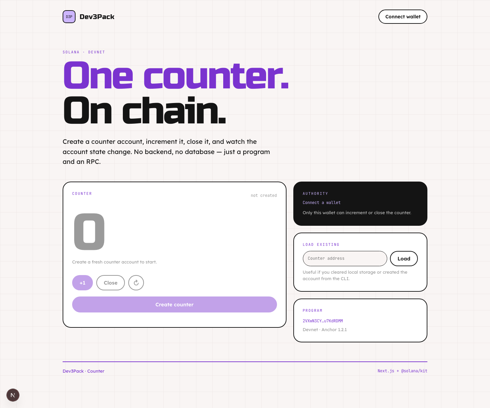

# Counter Frontend — Next.js + Solana Kit

A minimal full-stack Solana app for the Anchor `counter` program.

- Connect a Wallet Standard wallet.
- Create a counter account.
- Increment it up to 10.
- Close it and return the rent.
- Load an existing counter address.



## Stack

| Layer | Technology |
| --- | --- |
| Frontend | Next.js 16, React 19, TypeScript |
| Solana client | `@solana/kit` 8.6, `@solana/kit-plugin-rpc`, `@solana/kit-plugin-wallet` |
| React bindings | `@solana/react` |
| Wallet | Wallet Standard, auto-discovered |
| Program | Anchor 1.2.1, `counter` |
| Network | devnet |

The UI uses the Dev3Pack palette and fonts: Lexend, Russo One, and JetBrains
Mono.

## Program

```text
Program ID: 2VXwN3CYDMWdFbXcjYxaUAZMqLA3StMjebaQu7KdRDMM
Cluster:    devnet
```

The program is deployed on devnet. If you redeploy it:

```bash
cd ..
anchor program deploy --provider.cluster devnet
```

`anchor program deploy` is the current command; `anchor deploy` is deprecated.

## Run

```bash
npm install
cp .env.example .env.local   # optional; change the RPC if needed
npm run dev
```

Open <http://localhost:3000> and install Phantom or Backpack if no wallet is
detected.

For a private RPC:

```bash
# .env.local
NEXT_PUBLIC_SOLANA_RPC_URL=https://devnet.helius-rpc.com/?api-key=...
```

## How it works

### `lib/client.ts`

One Kit client at module scope:

```ts
createClient()
  .use(walletSigner({ chain: "solana:devnet" }))
  .use(solanaRpc({ rpcUrl }));
```

`walletSigner` makes the connected wallet the fee payer and identity.
`solanaRpc` adds `client.rpc`, subscriptions, and `client.sendTransaction`.

### `lib/counter.ts`

A small typed client built from the generated Anchor IDL:

- instruction discriminators,
- account metas and roles,
- `Counter` account decoder.

The counter is **not a PDA**, so `initialize` creates a normal account and the
new keypair must sign. The frontend generates that keypair and stores the
address in `localStorage` under `dev3pack:counter`.

### `lib/send.ts`

`client.sendTransaction` only knows the wallet signer. `initialize` needs one
extra signer, so this helper:

1. builds a v0 message,
2. adds the counter keypair with `addSignersToTransactionMessage`,
3. signs and sends with `sendAndConfirmTransactionFactory`.

`increment` and `close` only need the wallet, so they use
`client.sendTransaction` directly.

### `app/page.tsx`

- wallet discovery and connect/disconnect,
- create / increment / close,
- load an existing counter address,
- fetch and decode the account,
- explorer links and error messages.

## Why not `@anchor-lang/core`?

Current Anchor docs say `@anchor-lang/core` is compatible with the **legacy**
`@solana/web3.js` v1 client, not the current Kit stack. For a new frontend we
use Kit + a small typed client. The IDL still drives the discriminators and
account layout; only three instructions means hand-writing the client is
smaller than adding a generated-client pipeline.

If the program grows, generate a Codama client from the IDL.

## Smoke test

The smoke test uses the CLI keypair and the same frontend instruction builders:

```bash
npm run smoke
```

It initializes a counter, increments it, closes it, and checks the account is
gone. It prints devnet Explorer links.

Expected:

```text
initialize: <signature>
after init: { count: 0n, ... }
increment: <signature>
after increment: { count: 1n, ... }
close: <signature>
after close: null
smoke test passed
```

## Check the build

```bash
npm run typecheck
npm run build
```

## Devnet vs localnet

The client is pinned to the `solana:devnet` wallet chain. For a local validator,
change `walletSigner` to the local chain and set
`NEXT_PUBLIC_SOLANA_RPC_URL=http://localhost:8899`.

## Notes

- Devnet only; do not put a mainnet keypair in this project.
- The frontend never sees a private key. The wallet signs.
- `localStorage` only stores the counter address, not keys.
- A closed counter account can be recreated; the address is not deleted from the
  ledger, just emptied and refunded.
- If you clear local storage, paste the counter address into **Load existing**.

## Sources

- <https://solana.com/docs/frontend/react-hooks>
- <https://solana.com/docs/frontend/nextjs-solana>
- <https://www.solanakit.com/docs/guides/sending-transactions>
- <https://www.solanakit.com/docs/guides/fetching-accounts>
- <https://www.anchor-lang.com/docs/clients/typescript>
